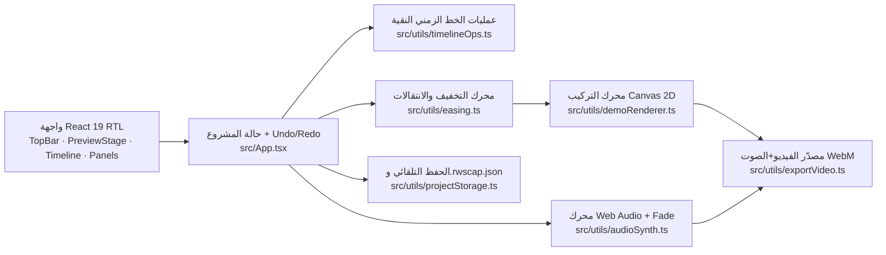

# RWSCap — محرر الفيديو العربي الاحترافي بواجهة CapCut

محرر فيديو عربي احترافي يعمل مباشرة في المتصفح بواجهة CapCut المظلمة للهواتف، يجمع بين خط زمني متعدد المسارات، انتقالات سينمائية، تحويلات وحركات مقاطع (بما فيها Ken Burns)، دمج صوت وفيديو حقيقي عند التصدير، وحفظ تلقائي + تصدير/استيراد ملفات `.rwscap.json` مع منظومة مهارات هندسية مدمجة (119 مهارة).

[التشغيل السريع](#quickstart) · [الميزات الاحترافية](#features) · [اختصارات لوحة المفاتيح](#shortcuts) · [المعمارية](#architecture) · [منظومة المهارات](#skills) · [الأوامر](#scripts)

---

<a id="quickstart"></a>
## التشغيل السريع (Quickstart)

المتطلبات: **Node.js 20+** و**npm 10+**.

```bash
git clone https://github.com/mimr5445-dev/rwscap.git
cd rwscap
npm install
npm run dev
```

يفتح التطبيق على `http://localhost:5173` (ويستمع على `0.0.0.0:5173` للمعاينة المباشرة وعلى الأجهزة ضمن الشبكة).

للتحقق الكامل (31 اختباراً + فحص أنواع + بناء الإنتاج):

```bash
npm test && npm run typecheck && npm run build
```

---

<a id="features"></a>
## الميزات الاحترافية

- **استوديو المشاهد التفاعلي بالمس (`StudioPanel` + `sceneActors.ts` + `actorRenderer.ts`)**:
  - مشهد **محطة الصحراء** التفاعلي (`public/scenes/desert-station.jpg` بنسبة `3:4`) مع إمكانية استيراد أي صورة مشهد أخرى.
  - **خزنة السيارات (6 موديلات)** و**خزنة الأشخاص (6 شخصيات)** مرسومة بأسلوب يتناغم مع إضاءة وظلال المشهد.
  - **التحريك والتسجيل بالمس في الوقت الفعلي**: المس أي مكان على الصورة لتوجيه السيارة أو الشخص إليه تلقائياً مع تسجيل الإجراء بالوقت، أو فعّل «● تسجيل حركة» واسحب العنصر بإصبعك لتسجيل المسار لحظياً، مع مسار عناصر ومفاتيح حركة (`◆`) في الخط الزمني وتصدير مباشر كفيديو `.webm`.
- **واجهة CapCut عربية RTL أصيلة**: شريط علوي (`تصدير` + `▾ 540P` + بحث + خيارات المشروع)، منصة معاينة حية، شريط تحكم، خط زمني تفاعلي بمؤشر مركزي أبيض وتكبير/تصغير (`−`/`+`)، وشريط أدوات سفلي متوافق مع التصميم المرجعي.
- **انتقالات سينمائية بين المقاطع**: 6 انتقالات احترافية (`تلاشي ناعم`، `تلاشي أسود`، `انزلاق أفقي`، `انزلاق عمودي`، `تكبير سينمائي`، `مسح جانبي`) بمدة قابلة للضبط (`0.2s–1.5s`) مع خيار «تطبيق على جميع الانتقالات» عبر أزرار الالتقاء (`⇄`) في الخط الزمني.
- **تحويل وتحريك المقاطع وتجميد الإطار**: تدوير 90°، عكس أفقي/عمودي، تكبير (`50%–200%`)، شفافية، إزاحة `X/Y`، حركات دخول و**Ken Burns** سينمائي، إدراج **إطار مجمّد** (`❄`) بضغطة واحدة، وإعادة ترتيب المقاطع (`تقديم/تأخير`).
- **نصوص وملصقات متحركة ومحاذاة مغناطيسية**: تحريك النصوص والملصقات (`انبثاق`، `تلاشي`، `صعود`، `آلة كاتبة` متوافقة مع الحروف العربية)، تعديل فوري للنصوص الموجودة، وخطوط محاذاة مغناطيسية سماوية عند المنتصف (`50%`) أثناء السحب.
- **صوت احترافي وتصدير فيديو+صوت مدمج**: تلاشي دخول/خروج صوتي (`fadeIn`/`fadeOut`) لكل مسار، مقياس مستوى صوتي حي، ودمج حقيقي لبث `Canvas` مع `Web Audio MediaStream` في ملف `.webm` (حتى دقة `2K/4K` و`60fps`).
- **حفظ تلقائي ومشاريع محمولة**: حفظ تلقائي متواصل في `localStorage` مع تصدير واستيراد ملفات `.rwscap.json` محمية بالتحقق الصارم من المخطط والأمان، وإدارة دورة حياة `URL.revokeObjectURL` لمنع تسرب الذاكرة.

---

<a id="shortcuts"></a>
## اختصارات لوحة المفاتيح

| الاختصار | الوظيفة |
|---|---|
| `Space` | تشغيل / إيقاف مؤقت |
| `←` / `→` | تحريك مؤشر التشغيل (±0.25 ثانية) |
| `S` | تقسيم المقطع عند مؤشر التشغيل |
| `M` | كتم / تفعيل الصوت |
| `Ctrl/⌘ + Z` / `Ctrl/⌘ + Shift + Z` | تراجع / إعادة |
| `Delete` / `Backspace` | حذف الطبقة أو المقطع المحدد |
| `?` | فتح خيارات المشروع ودليل الاختصارات |
| `Esc` | إغلاق اللوحة أو النافذة أو وضع ملء الشاشة |

---

<a id="architecture"></a>
## المعمارية



<details>
<summary>هيكل المجلدات والملفات الأساسية</summary>

- `src/App.tsx` — إدارة حالة المشروع، التراجع/الإعادة، الحفظ التلقائي، اختصارات لوحة المفاتيح، وإدارة موارد Blob.
- `src/types/editor.ts` — نماذج البيانات الكاملة للمقاطع، الانتقالات، التحويلات، الحركات، الصوت، والنصوص.
- `src/utils/` — `easing.ts`, `timelineOps.ts`, `projectStorage.ts`, `demoRenderer.ts`, `audioSynth.ts`, `exportVideo.ts`, `time.ts`, `cn.ts`, وحزمتا اختبارات `__tests__/editor.test.ts` و`__tests__/proFeatures.test.ts`.
- `src/components/` — `TopBar`, `PreviewStage`, `TransportBar`, `Timeline`, `BottomToolbar`, `icons/CapCutIcons`, الألواح الاحترافية (`TransitionPanel`, `TransformPanel`, `AnimationPanel`, `TextPanel`, `StickersPanel`, `AudioPanel`, `AdjustPanel`, `FilterPanel`, `AspectPanel`, `BackgroundPanel`, `CaptionsPanel`, `OverlayPanel`, `ClipControlsPanel`)، والنوافذ (`ExportModal`, `CoverModal`, `SearchModal`, `ProjectModal`, `AlertDialog`).
- `DESIGN.md` — توثيق نظام التصميم، رموز الألوان، مقياس العمق، وقواعد RTL/LTR.
- `AGENTS.md` & `SKILLS_MASTER_PLAN.md` — موجه الوكلاء والمخطط الكامل لمنظومة المهارات.
- `.agents/` — 119 مهارة (`skills/`), 12 قاعدة هندسية (`rules/`), الفهرس الآلي (`skills/registry.json`), وذاكرة المشروع (`memory/`).

</details>

---

<a id="skills"></a>
## منظومة المهارات المدمجة (`.agents/`)

يضم المستودع جميع مهارات التطوير المستوردة من Google Drive منظّمة في **7 حزم** تحت `.agents/skills/` (بإجمالي **119 مهارة** + **12 قاعدة**):

| الحزمة | العدد | النطاق |
|---|---|---|
| `superpowers` | 15 | العصف الذهني، الخطط، TDD، التصحيح المنهجي، المراجعة، والتحقق قبل الإتمام |
| `context-engineering-kit` | 68 | هندسة السياق، Kaizen، Reflexion، SDD/SADD، الاختبار، التوثيق، Git وMCP |
| `skills-2-curated` | 17 | تصميم الواجهة الأمامية، نظام التصميم، تدقيق الوصولية، المعمارية، الأمان، QA، الذاكرة، سجل الأخطاء، وRemotion |
| `ui-skills` | 10 | صقل الواجهة (`baseline-ui`)، الوصولية، Metadata، الأداء الحركي، و`DESIGN.md` |
| `ui-ux-pro-max` | 7 | ذكاء UI/UX مع قواعد بيانات CSV، نظام التصميم، العلامة التجارية، والتنسيق |
| `termux-github-master` | 1 | بروتوكولات وأدوات Termux وGitHub بالعربية |
| `repository-forensic-reader` | 1 | التحليل الجنائي وفحص المستودعات |

راجع **`SKILLS_MASTER_PLAN.md`** للمخطط الكامل ومصفوفة التوجيه حسب المهمة، و**`AGENTS.md`** لتعليمات التشغيل الفورية للوكلاء.

---

<a id="scripts"></a>
## الأوامر المتاحة

| الأمر | الوصف |
|---|---|
| `npm run dev` | تشغيل خادم التطوير على `0.0.0.0:5173` |
| `npm test` | تشغيل حزمة اختبارات Vitest (`38` اختباراً) |
| `npm run typecheck` | فحص TypeScript الصارم (`tsc --noEmit`) |
| `npm run build` | فحص الأنواع وبناء نسخة الإنتاج في `dist/` |
| `npm run preview` | معاينة نسخة الإنتاج محلياً على المنفذ `4173` |

## الحدود الحالية

- التصدير يعتمد على دعم المتصفح لـ `MediaRecorder` (`video/webm` مع ترميز `vp9,opus` أو `vp8,opus`).
- ملفات الوسائط المرفوعة محلياً (روابط `blob:`) تبقى مؤقتة في جلسة المتصفح وتُصفّى بأمان عند تصدير ملف `.rwscap.json` أو إعادة فتح المشروع لاحقاً.
