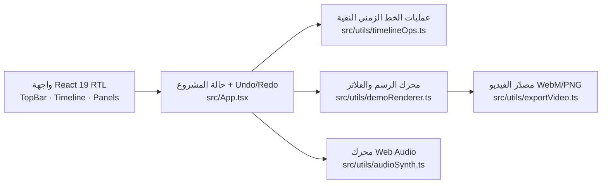

# RWSCap — محرر الفيديو العربي بواجهة CapCut

محرر فيديو عربي تفاعلي يعمل مباشرة في المتصفح بواجهة CapCut المظلمة للهواتف، يجمع بين خط زمني احترافي ومعاينة Canvas 2D وتصدير فيديو مباشر ومنظومة مهارات هندسية مدمجة (119 مهارة).

[التشغيل السريع](#quickstart) · [الميزات](#features) · [المعمارية](#architecture) · [منظومة المهارات](#skills) · [الأوامر](#scripts)

---

<a id="quickstart"></a>
## التشغيل السريع (Quickstart)

المتطلبات: **Node.js 20+** و**npm 10+**.

```bash
git clone https://github.com/mimr5445-dev/rwscap.git
cd rwscap
npm install
npm run dev
```

يفتح التطبيق على `http://localhost:5173` (ويستمع على `0.0.0.0:5173` للمعاينة المباشرة وعلى الأجهزة ضمن الشبكة).

للتحقق الكامل (اختبارات + فحص أنواع + بناء الإنتاج):

```bash
npm test && npm run typecheck && npm run build
```

---

<a id="features"></a>
## الميزات الرئيسية

- **واجهة CapCut عربية RTL متكاملة**: شريط علوي (`تصدير` + `▾ 540P` + بحث + إغلاق)، منصة معاينة حية، شريط تحكم (تشغيل/إيقاف، تراجع/إعادة، ربط المسارات `ON/OFF`، ملء الشاشة)، خط زمني تفاعلي بمؤشر مركزي أبيض، وشريط أدوات سفلي قابل للتمرير.
- **تحرير متعدد الطبقات**: استيراد فيديو وصور من الجهاز أو مقاطع تجريبية، تقسيم، قص من الطرفين، تكرار، حذف، تحكم بالسرعة والصوت، كتم صوت المقطع، وتعديل الغلاف.
- **مؤثرات بصرية وصوتية**: ضبط الألوان (السطوع، التباين، التشبع، التعريض، الحدة)، فلاتر جاهزة، أبعاد العرض (`16:9`, `9:16`, `1:1`, `4:3`, `3:4`, `2.35:1`)، خلفية لونية أو مموّهة، نصوص وشروحات وملصقات قابلة للسحب، تراكب PIP، ومحرك Web Audio مدمج.
- **تصدير مباشر من المتصفح**: تسجيل اللوحة عبر `Canvas.captureStream` + `MediaRecorder` بصيغة `.webm` مع بديل لقطة `PNG` عند عدم دعم التسجيل.
- **إمكانية الوصول والأداء**: دعم `role="dialog"` و`AlertDialog` للإجراءات التدميرية، اختصارات لوحة المفاتيح (`Space`, `Ctrl+Z`, `Escape`)، احترام `prefers-reduced-motion`، وإيقاف التشغيل تلقائياً عند إخفاء التبويب.

---

<a id="architecture"></a>
## المعمارية



<details>
<summary>هيكل المجلدات والملفات الأساسية</summary>

- `src/App.tsx` — إدارة حالة المشروع، التراجع/الإعادة، حلقة التشغيل، والألواح والنوافذ.
- `src/types/editor.ts` — الأنواع والإعدادات الافتراضية للمشروع.
- `src/utils/` — `timelineOps.ts`, `demoRenderer.ts`, `audioSynth.ts`, `exportVideo.ts`, `time.ts`, `cn.ts`, واختبارات `__tests__/editor.test.ts`.
- `src/components/` — `TopBar`, `PreviewStage`, `TransportBar`, `Timeline`, `BottomToolbar`, `icons/CapCutIcons`, `panels/*`, `modals/*`.
- `DESIGN.md` — توثيق نظام التصميم، رموز الألوان، مقياس العمق، وقواعد RTL/LTR.
- `AGENTS.md` & `SKILLS_MASTER_PLAN.md` — موجه الوكلاء والمخطط الكامل لمنظومة المهارات.
- `.agents/` — 119 مهارة (`skills/`), 12 قاعدة هندسية (`rules/`), الفهرس الآلي (`skills/registry.json`), وذاكرة المشروع (`memory/`).

</details>

---

<a id="skills"></a>
## منظومة المهارات المدمجة (`.agents/`)

يضم المستودع جميع مهارات التطوير المستوردة من Google Drive منظّمة في **7 حزم** تحت `.agents/skills/` (بإجمالي **119 مهارة** + **12 قاعدة**):

| الحزمة | العدد | النطاق |
|---|---|---|
| `superpowers` | 15 | العصف الذهني، الخطط، TDD، التصحيح المنهجي، المراجعة، والتحقق قبل الإتمام |
| `context-engineering-kit` | 68 | هندسة السياق، Kaizen، Reflexion، SDD/SADD، الاختبار، التوثيق، Git وMCP |
| `skills-2-curated` | 17 | تصميم الواجهة الأمامية، نظام التصميم، تدقيق الوصولية، المعمارية، الأمان، QA، الذاكرة، سجل الأخطاء، وRemotion |
| `ui-skills` | 10 | صقل الواجهة (`baseline-ui`)، الوصولية، Metadata، الأداء الحركي، و`DESIGN.md` |
| `ui-ux-pro-max` | 7 | ذكاء UI/UX مع قواعد بيانات CSV، نظام التصميم، العلامة التجارية، والتنسيق |
| `termux-github-master` | 1 | بروتوكولات وأدوات Termux وGitHub بالعربية |
| `repository-forensic-reader` | 1 | التحليل الجنائي وفحص المستودعات |

راجع **`SKILLS_MASTER_PLAN.md`** للمخطط الكامل ومصفوفة التوجيه حسب المهمة، و**`AGENTS.md`** لتعليمات التشغيل الفورية للوكلاء.

---

<a id="scripts"></a>
## الأوامر المتاحة

| الأمر | الوصف |
|---|---|
| `npm run dev` | تشغيل خادم التطوير على `0.0.0.0:5173` |
| `npm test` | تشغيل حزمة اختبارات Vitest (`16` اختباراً) |
| `npm run typecheck` | فحص TypeScript الصارم (`tsc --noEmit`) |
| `npm run build` | فحص الأنواع وبناء نسخة الإنتاج في `dist/` |
| `npm run preview` | معاينة نسخة الإنتاج محلياً على المنفذ `4173` |

## الحدود الحالية

- التصدير يعتمد على دعم المتصفح لـ `MediaRecorder` (`video/webm`)؛ في المتصفحات غير الداعمة يسقط تلقائياً إلى تصدير صورة `PNG` للإطار الحالي.
- المعاينة والتخزين محليان بالكامل داخل المتصفح (`localStorage` لحفظ بيانات المسودة) دون خادم خلفي.
