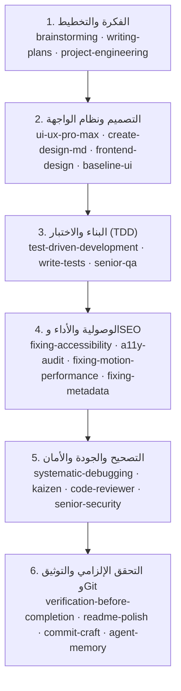

# المخطط الشامل لمنظومة المهارات (SKILLS_MASTER_PLAN) — مشروع RWSCap

> هذا المخطط يدمج **جميع المهارات الموجودة في Google Drive (`03_Skills_and_Agent_Configs`)** كجزء أصيل ومنظّم داخل مستودع `rwscap` تحت `.agents/skills/`، مع محرك توجيه ذكي يختار **المهارة المناسبة حسب نوع المهمة** دون إغراق السياق أو تضارب التعليمات.

---

## 1. ملخص المنظومة المدمجة (System Inventory)

تم جرد واستخراج وتطبيع جميع حزم المهارات في Google Drive (`skills` 108 عناصر + `skills 2` 100 مجلد + `مهاره نسخ المستودعات.zip`) وإزالة التكرارات الثنائية والملفات غير النصية، لتصبح المنظومة داخل المستودع كالتالي:

| # | الحزمة داخل المستودع | المصدر في Google Drive | العدد | الدور الرئيسي |
|---|---|---|---|---|
| 1 | `.agents/skills/superpowers/` | `superpowers-main.zip` + مجلدات Superpowers العربية | **15 مهارة** | العمود الفقري لسير العمل: العصف الذهني، الخطط، TDD، التصحيح المنهجي، المراجعة، والتحقق الإلزامي |
| 2 | `.agents/skills/context-engineering-kit/` | `context-engineering-kit-master.zip` + مجلدات هندسة السياق | **68 مهارة** | هندسة السياق، SDD/SADD، Kaizen، Reflexion، FPF، التوثيق، Git/PR، MCP، والوكلاء المتوازية |
| 3 | `.agents/skills/ui-skills/` | `ui-skills-main.zip` + مجلدات واجهات المستخدم | **10 مهارات** | صقل الواجهة (`baseline-ui`)، الوصولية (`fixing-accessibility`)، SEO/Metadata (`fixing-metadata`)، الأداء الحركي (`fixing-motion-performance`)، و`create-design-md` |
| 4 | `.agents/skills/ui-ux-pro-max/` | `ui-ux-pro-max-skill-main.zip` + مجلدات UI/UX Pro Max | **7 مهارات** + قواعد بيانات CSV وسكربتات | ذكاء التصميم `ui-ux-pro-max`، أنظمة التصميم، الهوية والعلامة، تنسيق الواجهات، البانرات، والعروض |
| 5 | `.agents/skills/termux-github-master/` | `TERMUX_GITHUB_MASTER.zip` | **1 حزمة متكاملة** (36 ملفاً) | أخصائي Termux وGitHub للهواتف العربية، بروتوكولات التنفيذ، سجل الأخطاء، والتسليم بين الجلسات |
| 6 | `.agents/skills/repository-forensic-reader/` | `مهاره نسخ المستودعات.zip` | **1 حزمة متكاملة** | القراءة الجنائية وفحص واستنساخ وتحليل المستودعات البرمجية بدقة |
| 7 | `.agents/skills/skills-2-curated/` | `Skills_Collections/skills 2` (أهم المهارات الفريدة غير المكررة) | **17 مهارة** | `frontend-design`، `ui-design-system`، `a11y-audit`، `readme-polish`، `code-reviewer`، `senior-architect`، `senior-security`، `senior-qa`، `project-engineering`، `agent-memory`، `memory-engineering`، `smart-error-ledger`، `remotion-motion-graphics`، `remotion-motion-factory`، `commit-craft`، `agent-harness`، `webapp-testing` |
| + | `.agents/rules/` | قواعد `context-engineering-kit/.claude/rules/` | **12 قاعدة** | انضباط المراجع، ميزانية الرموز، تحديث الروابط، وعدم تعارض المخططات |
| + | `.agents/memory/` | تطبيق `agent-memory` + `smart-error-ledger` | **ملفان حيان** | `PROJECT_STATE.md` (الذاكرة المعتمدة L2) و`ERROR_LEDGER.md` (سجل الأخطاء الذكي) |
| + | `.agents/skills/registry.json` | فهرس آلي مولّد لكل `SKILL.md` | **119 مهارة + 8 مسارات** | سجل JSON قابل للقراءة آلياً لربط كل مهمة بمهاراتها المحددة |

> **الإجمالي المثبّت محلياً داخل المستودع**: **119 مهارة (`SKILL.md`)** + **12 قاعدة هندسية** + **نظام ذاكرة حي** + **نقطة توجيه جذرية (`AGENTS.md`)**.

---

## 2. مخطط دورة حياة استخدام المهارات (SDLC Architecture)

---

## 3. مصفوفة التوجيه الذكي حسب المهمة (Task → Skill Matrix)

قاعدة التوجيه الذهبية (من `agent-harness` و`project-engineering`): **لا تشغّل كل المهارات عشوائياً؛ اختر مسار المهمة فقط، نفّذ، تحقّق بالأوامر، ثم أغلِق.**

| المرحلة / نوع المهمة | متى تُستخدم؟ | المهارات المُفعَّلة بالترتيب | المخرج المطلوب للتحقق |
|---|---|---|---|
| **تخطيط ميزة جديدة** | قبل كتابة كود لميزة متعددة الملفات (مثل: انتقالات الفيديو، طبقات صوت متعددة، قوالب جاهزة) | `superpowers/brainstorming` → `superpowers/writing-plans` → `context-engineering-kit/plan-task` → `skills-2-curated/project-engineering` | خطة مكتوبة بخطوات صغيرة وقابلة للتحقق |
| **تطوير واجهة أو لوحة أدوات** | تعديل شريط الأدوات، الخط الزمني، الألوان، أو إضافة Panel جديدة | `ui-ux-pro-max/ui-ux-pro-max` + `ui-skills/baseline-ui` + `skills-2-curated/frontend-design` + قراءة `DESIGN.md` | التزام كامل برموز `DESIGN.md` و`cn()` و`h-dvh` |
| **تدقيق إمكانية الوصول** | إضافة أزرار أيقونية، نوافذ منبثقة، منزلقات، أو اختصارات لوحة مفاتيح | `ui-skills/fixing-accessibility` + `skills-2-curated/a11y-audit` | `role="dialog"`، `aria-label`، `Escape`، `:focus-visible`، عدم حجب التكبير |
| **البيانات الوصفية وPWA** | تعديل `index.html` أو الأيقونات أو بطاقات المشاركة | `ui-skills/fixing-metadata` | عنوان، وصف، Open Graph، Favicon، `manifest.webmanifest`، JSON-LD |
| **محرك الرسم والحركة والفيديو** | تعديل `PreviewStage`, `demoRenderer`, `exportVideo` أو إضافة مؤثرات حركة | `ui-skills/fixing-motion-performance` + `skills-2-curated/remotion-motion-graphics` + `skills-2-curated/remotion-motion-factory` | عدم تمرير فلاتر وهمية، إيقاف `rAF` عند `document.hidden`، استخدام `clamp()` |
| **بناء منطق أو إصلاح خلل (TDD)** | أي تعديل على حسابات الخط الزمني، القص، التقسيم، الصوت، أو حالة المشروع | `superpowers/test-driven-development` → `context-engineering-kit/write-tests` → `skills-2-curated/senior-qa` | اختبار فاشل أولاً (RED) ← تنفيذ أدنى (GREEN) ← `npm test` ناجح |
| **تشخيص خطأ معقّد** | فشل بناء، انكسار تخطيط، تجمّد معاينة، أو سلوك غير متوقع | `superpowers/systematic-debugging` → `context-engineering-kit/root-cause-tracing` → `context-engineering-kit/why` → `skills-2-curated/smart-error-ledger` | تحديد السبب الجذري وتوثيق الدرس في `.agents/memory/ERROR_LEDGER.md` |
| **مراجعة معمارية وأمنية وكود** | قبل فتح/تحديث PR أو بعد إعادة هيكلة كبيرة | `skills-2-curated/senior-architect` + `skills-2-curated/senior-security` + `skills-2-curated/code-reviewer` + `context-engineering-kit/review-local-changes` | مراجعة Diff، صفر أسرار، فصل طبقات نظيف، كود بلا تحذيرات |
| **التوثيق والذاكرة وGit** | تحديث `README.md`، تسجيل الحقائق، تقسيم الالتزامات، أو العمل من Termux | `skills-2-curated/readme-polish` + `skills-2-curated/agent-memory` + `skills-2-curated/commit-craft` + `termux-github-master` | `README` يجتاز اختبار 15 ثانية + التزامات منطقية نظيفة |
| **بوابة الإتمام النهائية (إلزامي)** | قبل إرسال أي نتيجة نهائية للمستخدم | `superpowers/verification-before-completion` | تنفيذ فعلي لـ `npm test && npm run typecheck && npm run build` بخروج `0` |

---

## 4. فهرس الحزم السبع بالتفصيل

### الحزمة 1: `superpowers` (15 مهارة — `.agents/skills/superpowers/`)
`brainstorming`, `writing-plans`, `executing-plans`, `test-driven-development`, `systematic-debugging`, `verification-before-completion`, `requesting-code-review`, `receiving-code-review`, `subagent-driven-development`, `dispatching-parallel-agents`, `using-git-worktrees`, `finishing-a-development-branch`, `using-superpowers`, `writing-skills`, `diagnosing-superpowers`.

### الحزمة 2: `context-engineering-kit` (68 مهارة + 12 قاعدة — `.agents/skills/context-engineering-kit/`)
- **التخطيط والتنفيذ والوكلاء**: `brainstorm`, `create-ideas`, `plan-task`, `add-task`, `implement-task`, `subagent-driven-development`, `launch-sub-agent`, `multi-agent-patterns`, `do-in-steps`, `do-in-parallel`, `do-and-judge`, `do-competitively`, `tree-of-thoughts`, `thought-based-reasoning`, `propose-hypotheses`, `actualize`, `decay`, `query`, `reset`, `status`.
- **الاختبار والجودة**: `test-driven-development`, `design-testing-strategy`, `write-tests`, `test-coverage`, `fix-tests`.
- **التحسين المستمر والتحليل (Kaizen & Reflexion)**: `kaizen`, `plan-do-check-act`, `analyse`, `analyse-problem`, `cause-and-effect`, `root-cause-tracing`, `why`, `reflect`, `critique`, `memorize`, `judge`, `judge-with-debate`.
- **المراجعة وGit وPR**: `review-local-changes`, `review-pr`, `traiage-review`, `commit`, `create-pr`, `attach-review-to-pr`, `load-pr-comments`, `resolve-fixed-pr-comments`, `load-issues`, `analyze-issue`, `git-notes`, `git-worktrees`.
- **التوثيق وهندسة السياق وMCP**: `update-docs`, `write-concisely`, `context-engineering`, `prompt-engineering`, `test-prompt`, `create-skill`, `test-skill`, `apply-anthropic-skill-best-practices`, `create-agent`, `agent-evaluation`, `create-command`, `create-workflow-command`, `create-hook`, `create-rule`, `build-mcp`, `setup-context7-mcp`, `setup-serena-mcp`, `setup-arxiv-mcp`, `setup-codemap-cli`.

### الحزمة 3: `ui-skills` (10 مهارات — `.agents/skills/ui-skills/`)
`baseline-ui`, `fixing-accessibility`, `fixing-metadata`, `fixing-motion-performance`, `improve-ui`, `create-design-md`, `component-canvas`, `create-canvas`, `device-frames`, `ui-skills-root`.

### الحزمة 4: `ui-ux-pro-max` (7 مهارات + قواعد بيانات — `.agents/skills/ui-ux-pro-max/`)
`ui-ux-pro-max` (مع قواعد بيانات CSV للأنماط والألوان والخطوط والأيقونات + سكربتات البحث), `design-system`, `design`, `ui-styling`, `brand`, `banner-design`, `slides`.

### الحزمة 5: `termux-github-master` (`.agents/skills/termux-github-master/`)
منظومة متكاملة للعمل من Termux وGitHub بالعربية (`00_CORE`, `01_TEACHING_ENGINE`, `02_TERMUX_SPECIALIST`, `03_GITHUB_SPECIALIST`, `05_OPERATION_PROTOCOLS`, `06_MEMORY_SYSTEM`, `08_PRACTICAL_LAB`, `09_AUTOMATION`, `10_TEMPLATES`).

### الحزمة 6: `repository-forensic-reader` (`.agents/skills/repository-forensic-reader/`)
مهارة القراءة الجنائية وفحص واستنساخ المستودعات (`SKILL.md`, `README.md`).

### الحزمة 7: `skills-2-curated` (17 مهارة منتقاة من `skills 2` — `.agents/skills/skills-2-curated/`)
`frontend-design`, `ui-design-system`, `a11y-audit`, `readme-polish`, `code-reviewer`, `senior-architect`, `senior-security`, `senior-qa`, `project-engineering`, `agent-memory`, `memory-engineering`, `smart-error-ledger`, `remotion-motion-graphics`, `remotion-motion-factory`, `commit-craft`, `agent-harness`, `webapp-testing`.

> **ملاحظة حول باقي مجلدات `skills 2` في Drive** (مثل مهارات PDF/DOCX/XLSX/PPTX/SaaS/Marketing/Playwright-Suite/DevOps-K8s): تبقى محفوظة في Drive تحت `1bPVwTKIXRkn-lZubVnd4ZfORBT0uk3yG` ويمكن استدعاؤها عند الحاجة لمهام خارج نطاق محرر الفيديو الويب، منعاً لتضخيم المستودع بمهارات غير مرتبطة بتطبيق `rwscap`.

---

## 5. سجل المهارات المطبّقة فعلياً على `rwscap` الآن (Execution Audit Log)

لم يقتصر العمل على إدراج المهارات في المستودع فقط، بل تم **تشغيل وتطبيق المهارات المناسبة لكل مهمة فعلياً** على كود `rwscap`:

| المهارة المُطبَّقة | المشكلة المكتشفة / الهدف | التطبيق الفعلي المنفّذ في المستودع |
|---|---|---|
| `create-design-md` + `ui-design-system` + `ui-ux-pro-max` + `frontend-design` | غياب مرجع رسمي موحّد لرموز التصميم والتخطيط | إنشاء `DESIGN.md` وتوحيد متغيرات CSS ومقياس `z-index` في `src/index.css` |
| `baseline-ui` | غياب أداة `cn()` + غياب `AlertDialog` قبل إعادة تعيين المشروع التدميرية | تثبيت `clsx` + `tailwind-merge`، إنشاء `src/utils/cn.ts`، بناء `src/components/modals/AlertDialog.tsx` وربطه بإعادة تعيين المشروع في `ProjectModal.tsx` |
| `fixing-accessibility` + `a11y-audit` | حظر التكبير في `viewport` + غياب `role="dialog"` و`Escape` و`aria-hidden` على الأيقونات و`aria-live` على الإشعارات | إزالة `user-scalable=no` في `index.html`، إضافة `aria-hidden="true" focusable="false"` على 28 أيقونة SVG، ترقية `ToolSheet` وجميع الـ Modals بـ `role="dialog"`, `aria-modal`, `aria-labelledby`, `Escape`، وإضافة `:focus-visible` و`aria-live="polite"` |
| `fixing-metadata` | نقص البيانات الوصفية وبطاقات المشاركة والأيقونة وManifest | ترقية `index.html` بـ description, Open Graph, Twitter Card, SVG favicon, JSON-LD `WebApplication` وإنشاء `public/manifest.webmanifest` |
| `fixing-motion-performance` + `remotion-motion-graphics` | استمرار حلقة `rAF` عند إخفاء التبويب + تمرير CSS filter غير محايد في Canvas 2D عند القيم الافتراضية | إضافة مستمع `visibilitychange` في `src/App.tsx` + تحسين `buildCssFilterString` في `src/utils/demoRenderer.ts` لإرجاع `'none'` عند القيم المحايدة + احترام `prefers-reduced-motion` |
| `test-driven-development` + `senior-qa` + `senior-architect` | غياب اختبارات آلية + وجود منطق عمليات الخط الزمني مضمّناً داخل `App.tsx` | تثبيت Vitest، كتابة 16 اختباراً أولاً (RED)، استخراج `src/utils/timelineOps.ts` النقي، ربطه بـ `App.tsx`، واجتياز `npm test` (16/16 GREEN) |
| `agent-memory` + `memory-engineering` + `smart-error-ledger` | عدم وجود ذاكرة مستمرة وسجل أخطاء بين الجلسات | إنشاء `.agents/memory/PROJECT_STATE.md` و`.agents/memory/ERROR_LEDGER.md` |
| `readme-polish` + `update-docs` + `write-concisely` | `README.md` كان يحتوي سطراً واحداً فقط | إعادة كتابة `README.md` وفق اختبار الـ 15 ثانية مع Quickstart ومخطط معماري وروابط موثّقة |
| `verification-before-completion` + `commit-craft` | ضمان جودة البناء قبل الدفع إلى GitHub | تشغيل `npm test && npm run typecheck && npm run build` والتحقق من خروج `0` قبل الالتزام والدفع على `arena/316aab97-rwscap` |
